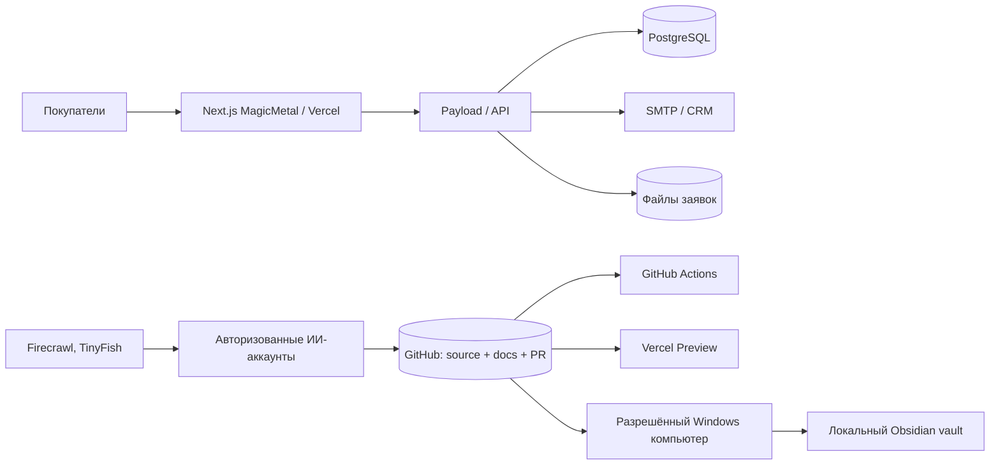

# MAGICMETAL — ПЕРВЫЙ ЗАПУСК НОВОГО ИИ-АККАУНТА

**Версия 2026-11-02.** Это основной операционный документ для загрузки в новый ИИ-аккаунт. Проект «Сайт1»; сайт https://magicmet.ru; GitHub https://github.com/ClaspBitKiln/magic-metal-next .

## 1. ПЕРВОЕ ПОРУЧЕНИЕ АГЕНТУ

Ты получаешь доступ к уже работающему проекту MagicMetal. Продолжай существующую работу, а не создавай проект заново. Читай текущее состояние из GitHub, никогда не полагайся исключительно на историю чатов. После первоначальной диагностики самостоятельно выполняй следующую безопасную задачу. Для подключения к сторонним сервисам используй предоставленные пользователем авторизации, не проси пароли в чате. Не обещай работу в фоне без реального механизма расписаний.

**Прежде любых правок прочитай по порядку**:
1. `site1.bootstrap.json`;
2. `docs/ai/FIRST_RUN_ACCOUNT_SETUP.md` (этот документ);
3. `docs/ai/PROJECT_SYSTEM_ARCHITECTURE.md`;
4. `docs/ai/CROSS_ACCOUNT_BOOTSTRAP.md`;
5. `AGENTS.md`, `MEMORY.md`, `docs/ai/AI_SITE_WORKFLOW.md`;
6. `.env.example`, `package.json`, `.github/workflows/`;
7. последние коммиты main, активные PR, результаты GitHub Actions, Vercel deployments.

## 2. МОДЕЛЬ СВЯЗИ ПРИЛОЖЕНИЙ



GitHub — единый источник правды о коде, документации и задачах. НЕ копируй клиентские заявки, секреты, БД или пароли в GitHub. Obsidian на Windows — локальная копия знаний, не автоматически двусторонняя синхронизация. Новый ИИ-аккаунт не наследует доступ к Windows, Vercel, Firecrawl, TinyFish, Gmail и другим приложениям от GitHub.

## 3. АВТОЗАПУСК ИЗ НОВОГО АККАУНТА

1. Пользователь предоставляет новому GitHub пользователю доступ к `ClaspBitKiln/magic-metal-next`; тот принимает приглашение. В новом ИИ-аккаунте подключают GitHub с разрешением на конкретный репозиторий.
2. Пользователь загружает этот файл или вставляет его первое поручение. Агент читает манифест и проверяет все подключения. **Вход в сам ИИ-аккаунт не является событием GitHub**, поэтому буквальный запуск при входе без первого сообщения не настроен.
3. После push в ветки `review/**`, `feat/**`, `fix/**` и создания PR по указанным путям GitHub Actions запускает `.github/workflows/site1-cross-account-validation.yml`, **когда workflow уже принят и активен для соответствующего события**. На дату документа файл находится в проверочной ветке PR #114, а не подтверждённо в main.
4. Vercel через Git-интеграцию создаёт preview. Из лога/интерфейса нужно получить фактический URL и состояние READY; не путай READY с работающей формой, проведи QA.
5. Для локального Obsidian отдельная задача `MagicMetal Catalog Sync` должна существовать на авторизованном Windows ПК. Новый аккаунт не может перенести её себе одной ссылкой.

## 4. НАСТРОЙКИ И ПОДКЛЮЧЕНИЯ (ПРОВЕРЯТЬ, НЕ ПЕРЕСОЗДАВАТЬ)

| Система | Назначение | Как проверить | При отсутствии доступа |
|---|---|---|---|
| GitHub | Код, PR, контекст | прочитать manifest и SHA main, открыть PR #114, Actions | запросить GitHub connector/приглашение |
| Vercel | preview/production | список deploys проекта `magic-metal-next`; SHA/READY/URL | отдельная авторизация к нужному team/project |
| Next.js | сайт и сборка | Node 22 в CI, `npm ci`, `npm run dev`, `npm run build -- --webpack` | прочитать log и next.config.ts |
| Payload | CMS и API | `src/collections`, server environment | не подменять secret |
| PostgreSQL | заявки и данные | только тестовая база; `DATABASE_URL` | получить секрет через разрешённый vault |
| Почта/CRM | уведомления о заявке | `SMTP_*`, `REQUEST_TO_EMAIL`, `CRM_WEBHOOK_URL`; тесты с моками | не отправлять реальное письмо из QA |
| Windows Desktop Commander | локальная автоматизация | список устройств, устройство Online, разрешение, минимальная проверка | запустить Remote agent и разрешить доступ на ПК |
| Obsidian | документация | Task Scheduler, last result, содержимое и hash vault файлов | отдельная настройка локального пути/задачи |
| Firecrawl | исследования, SEO/конкуренты | доступный connector, один контролируемый запрос | отдельное подключение нового AI-аккаунта |
| TinyFish | браузерные ИИ-агенты | профиль/доступ, запустить задачу и дождаться результата | отдельная авторизация и при необходимости browser profile |

**Конфигурация без секретов:** `site1.bootstrap.json`, `.env.example`. Реальные значения хранить в Vercel Environment и GitHub Secrets по надобности. **Локальный docker-compose описывает PostgreSQL 17**, а на одном Windows ПК также установлен PostgreSQL 16: это разные инсталляции, нельзя автоматически считать их одной БД.

## 5. ЗАПУСК С НОВОГО КОМПЬЮТЕРА

```bash
git clone https://github.com/ClaspBitKiln/magic-metal-next.git
cd magic-metal-next
git fetch origin
git status
node --version
npm ci
npm run lint
npm run test:int
npm run dev
```

Для работы использовать Node.js 22 как в GitHub Actions, если на машине есть 24-я версия — не считать совместимость доказанной. Для preview только отдельная ветка и PR. Не выполнять `git reset --hard` в старом checkout; если там есть изменения, создавать новый worktree/клон.

## 6. ОШИБКИ И ПРАВИЛЬНОЕ ВОССТАНОВЛЕНИЕ — ИЗ НАШЕЙ ПРАКТИКИ

**А. Конфликт аккаунтов и большой отрыв от main.**
Был dirty checkout с 8 изменёнными и 2 новыми файлами, отстававший от main более чем на 200 коммитов. Решение: сохранить patch и untracked файлы, выполнить fetch, создать чистый `git worktree add -b ... origin/main`, перенести только необходимые части diff, сделать тесты и PR. Не выполнять `reset --hard`, не копировать целиком старые версии файлов поверх актуальных.

**Б. GitHub push и CI.**
Изменения в `review/ferrosplavy-20261102` успешно пушились; PR #114 использовался как draft. Наличие YAML не доказывает, что GitHub Actions отработал: проверить вкладку Actions/checks и лог по конкретному SHA. `workflow_dispatch` требует workflow в default branch для кнопки запуска. Нельзя автоматически merge draft PR.

**В. Ошибки структуры каталога.**
При добавлении ферросплавов данные и статический файл `public/home-static.html` разошлись. Было 4 падения структурных тестов: размер количества строк, отсутствие категории в HTML, нет ссылок на раздел характеристик, неверное представление спецификаций. Исправить оба источника, ссылки `#sizes`, проверки и пересчитать числа по реальному каталогу, а не просто менять ожидаемое число вслепую.

**Г. Нормативы и марки.**
Были неполные обозначения феррохрома, ферротитана и феррованадия. Проверять ГОСТ и полные суффиксы марок; не вычислять химический состав «по названию», не подменять сертификат партии, не сообщать неподтверждённые остатки. Верифицированные документы и ограничения: `docs/ai/FERROSPLAVY_NORM_REVIEW_2026-11-02.md`. Следить, чтобы ссылки на карточках вели к точным текстам документа, а не к общему реестру. Не заявлять официальность стороннего зеркала.

**Д. Ложные ссылки и ошибки источников.**
Часть ссылок в `ferroDimensionGuides.ts` первоначально вели на общую выдачу реестра; исправили на ссылки конкретных ГОСТ. Если новый адрес не подтверждён, оставить позицию на проверку, не выдумывать URL. Сверять код с реально возвращённой страницей, не просто HTTP 200.

**Е. Сборка Next.js.**
Полная Windows-сборка `npm run build -- --webpack` заняла несколько минут, компилировалась с предупреждениями, отдельные страницы повторно генерировались после таймаутов, но завершилась `exit 0`, 203/203 страниц. Во время сборки удалённый терминал мог не отвечать — не запускать второй build параллельно. В используемом режиме пропускалась проверка TypeScript отдельных внутренних модулей, поэтому успешный build НЕ равен полному typecheck.

**Ж. Недостаточно места на Windows.**
C: был почти заполнен (~0,18 ГБ). Очистка npm cache и удаление 20 скачанных EXE/MSI установщиков освободила несколько ГБ; позже удалены Kimi и Antigravity с явного разрешения пользователя. Не удалять проект, PostgreSQL, Obsidian, синхронизацию и другие установленные программы по предположению. При очистке PowerShell удаление прошло, но журнал FileInfo ошибочно показывал ноль удалённых: проверять итог фактически (Test-Path и свободное место).

**З. Obsidian «задача успешно завершена» ≠ документы синхронизированы.**
Проверять: `Get-ScheduledTask -TaskName 'MagicMetal Catalog Sync'`, `Get-ScheduledTaskInfo`, файлы в vault и совпадение SHA256 с источником. Был случай, когда script exit 0, но нужный каталог не обновлялся; ручное копирование аудита и hash подтвердили только конкретные файлы. Режим «всегда автоматически» на всех ПК пока не подтверждён.

**И. Remote Desktop недоступен/нестабилен.**
Устройство `DESKTOP-BNPIVK2` иногда показывало Online с задержкой или transient `fetch failed`, иногда команда оставалась в running без вывода. Сначала повторно list_devices/проверить активный сеанс; для длинных команд использовать PID и read_process_output; не запускать второй тяжёлый процесс при задержке. Если нет авторизации устройства, запросить доступ. Старый deviceId не гарантирован для нового аккаунта.

**К. Тесты спецификации выявили ошибку regex.**
Использование `\b` после кириллических `кг`, `т`, `шт` не распознавало единицы: ASCII-ориентированная граница слова. Исправили на explicit lookahead `(?=$|[\s,.;)])`. Строка «М1 — 2 т» всё равно требует уточнения изделия/размера — не считать её полной спецификацией. Оригинальные строки и номера сохранять, никакого автоугадывания. Тесты: `tests/int/specification-triage.int.spec.ts`.

**Л. Поиск по маркам.**
Поиск построен на `src/data/searchIndex.ts` и `src/components/CatalogSearch.tsx`; не создавать второй несовместимый индекс. Реальные регрессионные тесты `tests/int/ferroalloy-search.int.spec.ts` проверяли `ФВд50У0,4`, `FeV80`, `ФХ001А/Б`, ГОСТ 27130-94. Убедиться, что результат ведёт на существующий маршрут и не заявляет наличие.

**М. Preview Vercel.**
`READY` было подтверждено для preview коммита `a71443b`, но полный UI/browser QA не был доказан. При 401/403 Vercel Deployment Protection использовать разрешённый `vercel curl` или профиль с авторизацией, **не отключать protection**. Не придумывать hostname preview. Для тестирования формы не отправлять настоящую заявку.

**Н. Сторонние браузерные агенты.**
TinyFish был использован для проверки текста ГОСТ 27130-94; у нового аккаунта нет автоматически browser profile/учётных данных. Долгие runs нужно ждать по выданному runId, не запускать дубль при timeout. Firecrawl `scrape` требовал обязательное поле `objective`; индексированные результаты конкурентов отделять от проверенных live-captures, DNS-сбой не выдавать за отсутствие конкурента.

**О. Кодировка и работа с PowerShell.**
Вывод кириллицы через удалённый PowerShell иногда отображался битым; это не обязательно порча файла. Для чтения используйте UTF-8 из GitHub/Node; для записи PowerShell `[System.IO.File]::WriteAllText(...,[System.Text.UTF8Encoding]::new($false))`. Проверять diff, file encoding, `git diff --check` до коммита. Не вставлять сломанную кириллицу из терминала обратно в репозиторий.

## 7. ПРОВЕРКИ ПЕРЕД ЗАВЕРШЕНИЕМ ЗАДАЧИ

1. `git diff --check`, `git status`.
2. `npm run lint`, релевантные `vitest`, при серьёзных изменениях `npm run build -- --webpack` и QA preview.
3. Готовность GitHub Actions по текущему SHA и состояние Vercel (READY/ERROR).
4. Файлы Obsidian, если менялась документация, и SHA256 совпадение.
5. Нет реальных заявок, тестовых писем, публикации непроверенных ГОСТ/наличия, нет утечек секретов.
6. Отчёт: что сделано, ветка/commit/PR, какие тесты, что не проверено, следующий безопасный шаг.

## 8. НЕОБХОДИМЫЕ ДОСТУПЫ И РАЗРЕШЕНИЯ

Владелец отдельно подтверждает права на GitHub, Vercel, Windows, Obsidian, почту, базы и инструменты агентов. Если какое-то подключение отсутствует, работай с доступными данными, но явно напиши «не подключено»; не проси пользователя копировать секреты в чат. Защищённые production операции и изменение прав только с разрешения пользователя.

## 9. ЧТО СЧИТАТЬ ЗАВЕРШЕНИЕМ ПЕРВОГО ЗАПУСКА

Отчёт из пяти частей:
- GitHub: доступ, SHA main, PR и checks;
- Vercel: доступ, активный preview/production, доступность URL;
- Windows/Obsidian: подключение, последняя задача и сверка;
- Секреты/БД/SMTP/агенты: только статусы доступности, **без значений секретов**;
- Приоритетная задача, безопасно выполненная в отдельной ветке, или чёткий блокер.

Затем работать по существующему плану проекта. Считать этот файл актуальной инструкцией, но **всегда сверять факты с GitHub и проверками в момент запуска**.
