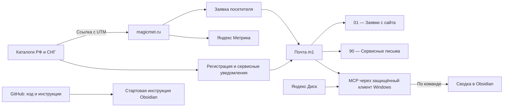

# Связки проекта Magic Metal и рабочие правила

Актуально: 22.11.2026. Цель — стабильный поток реальных заявок. Матрица поставщиков и автоматизация КП приостановлены. Новые расписания не создавать.

## Как связаны системы

Ссылка на сайт не является заявкой. Клик по почте открывает почтовую программу/веб-почту посетителя, если это настроено. Метрика фиксирует нажатие, а не отправку письма. В Метрике, почте и кабинетах площадок разные показатели; не складывать их как число клиентов.

## Где начинать новому аккаунту

- Vault: `C:\Users\asus\Documents\inn-bot`.
- Основная инструкция: [[00 - Инструкция старт - все подключения]].
- Почта: [[Подключение Яндекс Почты — m1@magicmet.ru]].
- Компьютер: DESKTOP-BNPIVK2, пользователь Windows asus; RDC device `5a436677-3504-4ffe-844c-05211febdc66`.
- GitHub: https://github.com/ClaspBitKiln/magic-metal-next . Текущую ветку/передачу сверять перед правками. Коммит документации не означает новый выпуск сайта.

## Почта и Диск

Рабочая почта: m1@magicmet.ru, https://mail.360.yandex.ru/ . Gmail — отдельное подключение.
Официальные MCP Mail/Disk проверены живыми запросами. В текущем ChatGPT они вызываются через RDC и локальный клиент, а не нативные инструменты Яндекса.
Каталог клиента: `%LOCALAPPDATA%\MagicMetalYandex360`. Токены `mail.token.dpapi`/`disk.token.dpapi` защищены DPAPI текущего Windows-пользователя и ACL. Значения не хранить в заметках, Git и чате.

`run-secure.ps1` вызывает инструмент с JSON-аргументами. Результаты сохранять в приватные файлы с уникальными именами. `mail-tools.json`/`disk-tools.json` содержат реальные схемы. Почта: 13 инструментов, Диск: 15. Официальный Mail MCP не отправляет письма; поддерживает чтение, поиск, черновики, метки и перемещение. Создание папок/правил выполнено через интерфейс Почты.

Папка `01 — Заявки с сайта`, ID9: тема содержит «Заявка с сайта:», перемещение и остановка остальных правил. Папка `90 — Сервисные письма`, ID10: узкие правила Glotr, Cataloxy и business@360.yandex.ru. Правила работают на стороне Почты без ИИ и расписания. Системные папки, прочитанность, письма и пароли не удалялись/не сбрасывались этой настройкой. Число писем не подтверждает число реальных заявок.

Сборщик `run-watch-secure.ps1` работает ТОЛЬКО ПО КОМАНДЕ. Получает заголовки писем и метаданные последних 50 загрузок Диска, не скачивает документы, не обрабатывает поставщиков и не отправляет сообщения. Отчёт: [[Automation/Почта и Диск — автоматическая сводка]]. 4 локальных теста и живой запуск прошли; первый запуск увидел 8 писем за выбранный интервал и 13 записей Диска, это не число новых клиентов. Новая задача Windows `MagicMetal Inbox and Disk Watch` удалена по указанию владельца, проверено Exists=false. Прочие существующие задачи не менялись.

## Каталоги и цены

- Glotr: компания C-6962566, внутренний ID41690, тариф FREE до100 товаров подтверждён письмом владельца. Кабинет https://glotr.uz/company/41690/ . Страна компании Россия, без выдуманного офиса в Узбекистане. Нативной RUB нет: «Цена по запросу», цены в рублях и справочных USD в описании. Не записывать рубли как сумы.
- Prom.uz: кабинет611809, товарный список https://my.prom.uz/app/products-all . Лимит бесплатного размещения остаётся неразрешённым: страницы правил противоречат друг другу. Оплату не подключать. Не создавать дубли карточек при обновлении.
- Cataloxy: компания4770865, контакт17661318, кабинет https://www.cataloxy.ru/cabinet/board.htm?products . РФ, цены RUB. Применяется база поставщика +2000 руб./т; не смешивать с экспортной моделью. Для штучной позиции без достоверной массы нельзя произвольно добавлять2000 руб./шт — договорная цена до подтверждения единицы расчёта.
- Flagma.ru: автоматизацию остановить — правила запрещают скрипты/боты без разрешения портала. Регистрация агентом не выполнена. Не обходить запрет имитацией человека.
- Фото и 2ГИС отложены по указанию владельца. VIPZAKAZ: ранее владелец отправил письмо по своему номеру, не дублировать запрос без проверки ответа.

Экономика партии20т уже выполнена и согласована; не считать заново без новых исходных цен/логистики. Диапазоны размеров не означают наличие всех сочетаний. Для клиента — понятные товар, параметры, условия и сайт; внутренние закупочные данные и поставщиков не раскрывать.

## Метрика и проверка результата

Счётчик113661397, timezone Asia/Yekaterinburg. Свежий GET-only отчёт за15–21 ноября получен22.11, без распознанных роботов, без семплирования. Подробные бизнес-цифры сохранены в отдельной приватной заметке [[2026-11-22 - Метрика и посещаемость]]. Частота запусков не увеличена; новых расписаний анализа нет.

`request_sent` — принятая форма, а не продажа. Клики телефона/email не равны состоявшимся звонкам/письмам. Исключение владельца предусмотрено production-кодом, но не доказано для всех его устройств и VPN. По географии нельзя автоматически определять местонахождение покупателя. Разбивка популярных страниц API неполная — не делать ложный рейтинг карточек.

Ссылки с UTM: источник glotr/cataloxy, medium marketplace. Production whitelist подтверждён для utm_source/utm_medium/utm_campaign; utm_content надёжно не сохраняется этой реализацией. Для товарной группы можно использовать понятный utm_campaign, не записывая персональные данные. Сайт ради этого без отдельной нужды не пересобирать.

## Полезные решения из GitHub

Изучен https://github.com/colibri11/yad — разделение сервисов, файловый вывод больших данных вместо base64 в контексте, диагностика подключения. Альтернативный https://github.com/gorokhovdenis/yandex-disk-mcp описывает фоновые загрузки и проверку файлов. Это справочные подходы: сторонние серверы не устанавливались, токены им не передавались. Уже работающий официальный MCP остаётся основным. SMTP у стороннего решения требует отдельной настройки и не появляется автоматически у официального Mail MCP.

## Правила продолжения

Один редактор на ресурс; независимую работу можно делегировать. Не повторять общий аудит, расчёты и успешные проверки без новых изменений. Перед Save сохранить квитанцию, после неизвестного результата прочитать состояние. После записи в Obsidian делать readback/хеш и сохранять резервную копию заменённой заметки. Не менять чужие незакоммиченные файлы. Новые расписания, поставщики/КП, MATBOOK, CMS/Neon и Beget/inn-bot не развивать в этой задаче.

## Текущее размещение и ограничения сводки

Glotr: пять товаров1180302/1180317/1180318/1180406/1180407. Продающие варианты применены только к двум новым: листы1180406 —A v1, круги1180407 —B v1. Остальные три не менялись. Все пять на модерации, публичных ссылок новых двух пока нет. Новая СДТ Cataloxy407933527 —B v1, кабинет сохранён, анонимная страница отвечает Checking…, публикация не подтверждена. Orgpage подготовлен, но город не закрепляется штатным выбором; регистрации/Submit нет.

Сборщик Почты просматривает настроенные папки9/10. Переписка клиентов во Входящих и native-заявки площадок могут не попадать в эту сводку. Это не полный реестр лидов/продаж.

[Тексты Glotr и реестр вариантов](GLOTR_SALES_COPY_20261122.md), [СДТ и проверка](CATALOXY_SDT_FINISH_20261122.md), [Orgpage: точный блокер](ORGPAGE_FINISH_20261122.md).
