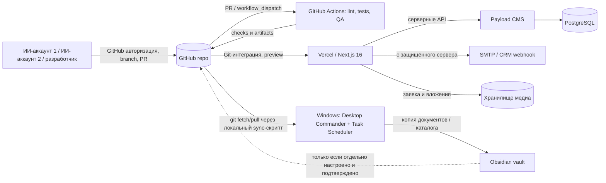

# MagicMetal — архитектура, взаимодействие приложений и запуск из разных ИИ-аккаунтов

Версия: 2026-11-02. Статус: документированная текущая схема + целевое устройство. **Не считать описанные будущие механизмы уже работающими.**

## 1. Единый источник истины

GitHub: https://github.com/ClaspBitKiln/magic-metal-next

- `main` — интеграционная/производственная база. Прямой push, force push и автоматический merge ИИ-агентам запрещены.
- `review/*`, `feat/*`, `fix/*` — изолированные ветки; изменения вносятся через PR, после проверки и разрешения конфликтов.
- Код и версия конфигурации хранятся в Git. Пароли, токены, клиентские заявки, медиа, БД и локальные пути — НЕ в Git.
- Контракт запуска: любой аккаунт GitHub с подходящими правами к репозиторию может запустить `workflow_dispatch`; любой ИИ-аккаунт с доступом к репозиторию может прочитать этот документ и создать PR. Это **не** даёт автоматически права к Vercel, БД, Obsidian или Windows.
- При параллельной работе нескольких аккаунтов: одна задача → одна ветка → один владелец PR; перед внесением изменений проверить `origin/main`, другие PR и `git status`. Не сбрасывать незакоммиченные изменения чужих веток.

## 2. Карта системы

**Потоки:** посетитель → сайт → форма → API / проверка → БД / почтовое уведомление. Браузерные и ИИ-агенты тестируют **preview**, не посылая реальные заявки. GitHub Actions не запускает напрямую Windows-программы на GitHub-hosted runner.

## 3. Реальные компоненты и точки входа

| Система | Назначение | Точка запуска/конфигурация | Доступ |
|---|---|---|---|
| GitHub | Исходники, PR, ревью, Actions | `.github/workflows/`, этот документ | Гранулированные права репозитория |
| Next.js | Веб-сайт MagicMetal | `npm run dev`, `npm run build -- --webpack` | Из клона GitHub |
| Vercel | Production/preview при Git push | Подключённый проект `magic-metal-next` | Отдельные роли Vercel |
| Payload | CMS, API, заявки | `src/collections/`, `npm run payload` | Серверные ключи |
| PostgreSQL | База данных | `DATABASE_URL`, `docker-compose.yml` (локально PostgreSQL 17 в контейнере; на Windows также обнаружена установленная версия 16) | Секрет подключения |
| SMTP/CRM | Доставка заявок | `SMTP_*`, `REQUEST_TO_EMAIL`, `CRM_WEBHOOK_URL` | Только окружение сервера |
| GitHub CI | QA, тесты, проверка доставки | `site-qa.yml`, `production-browser-qa.yml`, `request-delivery-integration.yml`, `catalog-live-audit.yml`, `live-hero-check.yml` | GitHub Actions |
| Локальная Windows-среда | Рабочие копии, команды на ПК | Desktop Commander Remote, PowerShell | Отдельное устройство/авторизация |
| Obsidian | База знаний и отчёты | Windows Task Scheduler: `MagicMetal Catalog Sync` | Локальный vault |
| Синхронизатор | GitHub → Obsidian | `%LOCALAPPDATA%\MagicMetalObsidianSync\Run-CatalogSync-Hidden.vbs` → JS-скрипт | Существует на конкретном ПК; не перенесён в Git |
| Агентный анализ | Конкуренты, ГОСТ, UI-исследования | Firecrawl, TinyFish, другие подключённые средства | Подключения выполняются отдельно в каждом ИИ-аккаунте |

**Важно:** точный локальный Windows-путь — пример существующей установки, а не обязательное расположение для другого компьютера. В репозитории находятся скрипты и код сайта; файл `Run-CatalogSync-Hidden.vbs` и локальный планировщик не появляются в другом аккаунте автоматически.

## 4. Быстрый запуск с нового устройства или ИИ-аккаунта

1. Получить разрешённый доступ к GitHub-репозиторию. Если репозиторий приватный, приглашение в Collaborators/Organization обязательно.
2. Открыть `docs/ai/CROSS_ACCOUNT_BOOTSTRAP.md`, `AGENTS.md`, `MEMORY.md` и `docs/ai/AI_SITE_WORKFLOW.md`. Сверить последние коммиты и открытые PR.
3. Для работы с кодом: `git clone https://github.com/ClaspBitKiln/magic-metal-next.git`, `npm ci`, `npm run dev`. Node.js 22 — версия GitHub Actions; применять `.env.example` для списка ключей, но реальные секреты получить через авторизованный менеджер секретов.
4. Для проверок без локального компьютера: GitHub → Actions → **Site1 cross-account validation** → Run workflow; выбрать ветку. Ветка и workflow должны быть доступны в GitHub Actions (сначала через review/merge workflow в default branch). При PR можно запускать проверки автоматически.
5. Для preview: создать PR и дождаться Vercel deployment READY; URL брать из Vercel/PR, а не придумывать. Проверять HTTP/DOM, мобильное отображение и путь заявки без фактической отправки.
6. Для Obsidian: на авторизованном Windows-хосте отдельно настроить Git, путь vault и задачу Task Scheduler; проверить последнюю задачу, exit code и хэши записанных файлов. Другой аккаунт без доступа к ПК может читать **только закоммиченные** документы GitHub.

## 5. Автоматический контур и ограничения

- Pull request: review, выделенные unit/int-тесты, lint; публикации в production **нет**.
- `workflow_dispatch`: явный запуск проверок авторизованным пользователем независимо от используемого ИИ-клиента, Node 22, `npm ci`, `vitest`, lint, отчёты GitHub Actions.
- Vercel: preview по соединённой Git-ветке; production **только** согласно политике main/релизных approvals.
- Post-deployment: уже есть `site-qa.yml`, запускаемый по successful Production deployment, и отдельные QA workflows. Не создавать конкурирующий production деплойер.
- Obsidian: task on one Windows device; **не полагаться на него как на бесшовный двусторонний sync**. Изменения vault не считаются загруженными в GitHub без отдельного процесса commit/push.
- Непроверенные марки/ГОСТ, наличие, сертификаты и цены никогда не формировать автоматически.
- Не допускать продублированных отправок реальных заявок агентами и QA.
- GitHub Actions не наследует личные плагины ChatGPT, browser profiles, Cloud credentials и локальные команды агента.

## 6. Безопасность / доступ

| Данные | Где хранить | В GitHub? |
|---|---|---|
| Код и обезличенные тесты | GitHub | Да |
| Перечень настроек, **без значений** | `.env.example`, docs | Да |
| SMTP, БД, CRM, облачные ключи | Vercel Environment / GitHub Actions secrets по назначению | Нет |
| Personal Access Token / SSH key | Менеджер секретов нового аккаунта | Нет |
| Контактные данные клиентов и файлы заявок | Ограниченное серверное хранилище | Нет |
| Obsidian vault и Desktop Commander credentials | Локальное защищённое устройство | Нет |
| GitHub Actions workflow permissions | Минимум `contents: read` для проверки | В YAML |

Требуются GitHub permissions, работающая Vercel Git integration, env vars и подключённая машина. Без их отдельной авторизации **нельзя обещать** автоматический запуск всех приложений из любого аккаунта.

## 7. Режим восстановления / handoff

Новый агент должен прочитать статус PR, найти задачи и повторить только идемпотентные операции. Начать с `git status`, `git fetch origin`, проверить чужие ветки, не выполнять `reset --hard`. По каждому этапу записывать: исходный SHA, изменения, команды тестов, результат, открытые риски, URL PR/preview, точку продолжения. Для одновременных правок одного файла использовать отдельные ветки и обычное merge/rebase с ручным разрешением конфликтов.

## 8. Текущие факты и пробелы

- Рабочая проверочная ветка ферросплавов: `review/ferrosplavy-20261102`, draft PR #114. Она включает дополнительные улучшения поиска/спецификации. Не объединять автоматически до ревью.
- В ноябре 2026 на одном Windows-хосте наблюдалась задача `MagicMetal Catalog Sync`; наличие и исправная работа на других ПК **не подтверждены**.
- Источники документа: фактическая структура GitHub checkout, `package.json`, `.env.example`, `docker-compose.yml`, `.github/workflows/`, Windows Task Scheduler и предыдущие результаты проверки ветки.
- Не реализованы: централизованное межаккаунтное управление правами, двусторонняя Obsidian-синхронизация, единый AI agent orchestrator, безусловная автоматическая публикация. Все эти функции требуют отдельной реализации/согласования.

Следующий документ: [CROSS_ACCOUNT_BOOTSTRAP.md](CROSS_ACCOUNT_BOOTSTRAP.md).
