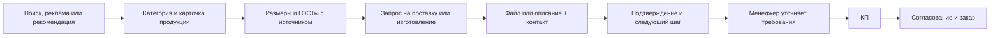

# Аудит сайта как воронки продаж

Проверен опубликованный https://magicmet.ru/ 13 октября 2026 года. Основа проверки: мобильный экран 390 px, текущая главная и форма, ранее проверенные переходы из каталога, карточек и справочников, обработчик заявки. Реальные заявки и письма не отправлялись. Данных о рекламных расходах, конверсии в КП и сделки нет; прогноз роста конверсии не рассчитывался.

Решение пользователя: отдельный лид-магнит не нужен. Цель — прямая воронка продаж: подбор продукции по ГОСТу или чертежу → заявка → КП → заказ. Главный приоритет текущего шага — убрать препятствия в форме. По решению пользователя пункты 4 (новое подтверждение и следующий шаг после отправки) и 5 (аналитика и отслеживание заявки до заказа) отменены. Отдельный лид-магнит также исключён.

## Что уже помогает продавать

- Конкретная специализация: сложные промышленные заявки, редкие позиции, ГОСТы, аналоги, документы и экспорт.
- Каталог с переходами от категории к продукции и её характеристикам.
- Сохранение выбранных наименований, размеров, марки и стандарта при переходе в заявку.
- Приём спецификаций, чертежей, фото и голосовых сообщений; доступные телефон и email.
- Лёгкая главная без загрузки React для первого экрана. Предыдущий лабораторный замер: полностью загруженный hero около 1,1–1,5 с при 1,6 Мбит/с, задержке 150 мс и замедлении CPU в 4 раза. Это симуляция, а не статистика посетителей.

## Найденные препятствия

| Приоритет | Наблюдение | Предлагаемая правка |
| --- | --- | --- |
| 1 | Спецификация приложена, контакт и согласие заполнены, но пустое описание блокирует форму. На живом сайте `checkValidity()` возвращает false; единственное невалидное поле — `message`. Обработчик уже разрешает файл вместо описания. | Принимать **файл или описание**, затем один способ связи. Явно написать «Достаточно телефона или email». |
| 1 | Заголовок «Отправьте заявку» плохо различим на синем фоне блока, особенно слово «заявку». | Сделать заголовок контрастным; на телефоне оставить короткую, читаемую форму. |
| 2 | «Отправить заявку» сообщает действие, но не конкретную пользу. Первый экран перечисляет возможности компании. | Рядом с существующим заголовком обозначить результат: проверка спецификации, вопросы по ГОСТам и вариант комплектации. Сделать кнопку с этим смыслом. |
| 2 | На опубликованной главной загружается только `home.js`; счётчики и события аналитики из React-компонента не подключены к статической странице. | Отменено пользователем; новых счётчиков и событий не добавлять. |
| 2 | Статическая форма передаёт `landingPage`, но не передаёт `utm_source`, `utm_medium`, `utm_campaign` и `referrer`, которые ожидает обработчик. URL страницы сохраняется, однако отдельные поля источника не заполняются. | Не входит в согласованный шаг; работа над аналитикой отменена. |
| 3 | Подтверждение сводится к «Мы свяжемся с вами». Пользователь не видит следующего шага, срока ответа или номера обращения. | Отменено пользователем; существующее сообщение после отправки сохраняется. |
| 3 | Есть сведения об опыте и логотипы подрядных организаций, но на главной нет коротких разборов конкретных задач и результата поставки. | Добавить 2–3 подтверждённых кейса: задача → решение → результат; приложить реальные фото и примеры документов с разрешением на публикацию. |

## Прямой запрос на поставку или изготовление

Основное действие — **«Получить расчёт по ГОСТу или чертежу»**. В каталоге остаётся переход «Размеры, описание и ГОСТы». Отдельная «Заявка на производство» удалена по решению пользователя; обычная заявка доступна в карточках и на главной. Клиент передаёт спецификацию либо краткое описание, затем один способ связи; выбранная продукция и известные параметры сохраняются.

В ответ компания уточняет требования и готовит коммерческое предложение на поставку или изготовление. Отдельные бесплатные материалы, выдача справочника за контакт и бесплатная проверка как самостоятельный оффер исключены по решению пользователя.

Размеры и таблицы ГОСТов полезны как открытая информация для подбора. В карточке нужны источник, редакция стандарта, тип/исполнение и ограничения применимости. Нормативный размер и подтверждённое наличие — разные сведения. Для заявки на изготовление особенно важны стандарт или чертёж, исполнение, материал, количество и требования к документам; их можно передать одним файлом.

## Целевой путь покупателя

## Согласованный короткий шаг

Пункты 1–3: принимать файл **или** описание, явно пояснить, что достаточно телефона **или** email, сделать заголовок формы читаемым на синем фоне. Исправления формы находятся в коммите `00d93f5`; подтверждение отправки и аналитика не изменялись. Проверены телефонный и компьютерный экраны, отрицательные случаи, сохранение файла после ошибки и форма без JavaScript. Отправка проверялась с тестовыми ответами сервера, без реальных заявок.

Оформление каталога: светлые заголовки и заметная ссылка на размеры/описание/ГОСТы; для оборудования без отдельной карточки — заявка на комплектацию. Отдельная «Заявка на производство» удалена по решению пользователя. Аналитика, новое сообщение после отправки и отдельный лид-магнит не добавляются. Таблицы размерного ряда размещаются в карточках с указанием конкретного стандарта и области применения; внешние ссылки на источники не выводятся по решению пользователя; главная не загружает полный размерный ряд. Актуальное наличие исключено из текущего шага по решению пользователя. Сверка с 23met.ru использует сохранённую выгрузку от 01.09.2026: прямой доступ к сайту 13.10.2026 отклонён сетевым прокси (403), актуальное наличие не подтверждалось.

## Размерный ряд: проверенная пачка 14.10.2026

Добавлены 26 таблиц / 737 компактных строк на 12 товарных страницах. Покрыты двутавры с уклоном полок, пять серий швеллера, горячекатаные уголки, круг редакции ГОСТ 2590-88, полоса, ВГП, прямошовные и профильные трубы, отводы 2D/3D и эллиптические заглушки, гайки. Фланцы — только показанные типы 01/11 при PN 16, ряд 1. Карточка полосы восстановлена: наименование уже присутствовало в прежнем перечне и практическом размерном ряду, но отдельный переход отсутствовал.

Это не полное покрытие всего каталога. Старый ГОСТ 8732-78 не перенесён в утверждённый ГОСТ 8732-2025; непроверенные новые редакции и иные исполнения не подменяются торговыми размерами. Проверки источников, точные границы и сравнения исторической выгрузки записаны в `docs/catalog/` и документах `PIPE_SIZE_SERIES_VERIFICATION.md`, `OTHER_SIZE_SERIES_GAPS.md`. Ссылки на источники в интерфейсе исключены, аналитика и наличие не добавлялись.

Предпочтён компактный серверный вывод: самостоятельные таблицы по ГОСТу и исполнению, подписи единиц, закреплённая шапка, первая таблица раскрыта, остальные открываются штатным `details`. Главная содержит диапазоны и обычные ссылки сразу к `#sizes`, без загрузки всех таблиц и без нового клиентского кода.

## Следующая короткая пачка 14.10.2026

Добавлены полный основной ряд горячедеформированных труб ГОСТ 8732-2025 (70 диаметров, 1793 сочетания с указанной массой в таблице 1) и горячекатаного квадрата ГОСТ 2591-2006 (65 номиналов). Всего теперь 28 таблиц / 872 компактные строки на 14 товарных страницах. Прочерки в таблице 1 ГОСТ 8732-2025 означают изготовление по согласованию; они не объявлены недопустимыми и не добавлены в основной ряд автоматически. Сверка со снимком 23met от 01.09.2026: 726/792 трубных обозначений и 33/45 обозначений квадрата. Остатки не анализировались.

Найден новый зафиксированный источник `SlyusarVA/metal-site`, ревизия `7e0f80d43ac2721e23b663823fddbc997b2e96de`, каталог `GOST METALL`. В нём также есть копии ГОСТ 35087-2024, 2590-2006, 8734-75, 19903-2015 и других стандартов для следующих небольших шагов. Найденный файл ГОСТ 8559-75 имеет числовые ошибки распознавания: калиброванный квадрат не заполнен этой копией. Ссылки источников в интерфейс не добавляются.

## Двутавры и дополнительные холоднодеформированные размеры 14.10.2026

Добавлена полная таблица 1 ГОСТ 35087-2024: 319 профилей, раздельные типы Б, Ш, К, С, ДБ, ДК, У. Нормальная серия Б открывается первой; прежний ГОСТ 8239-89 остаётся отдельной таблицей. Сверка исторического снимка 23met: 94/170 обозначений.

Холоднодеформированные трубы: опубликованы только дополнительные размеры из примечания 2 ГОСТ 8734-75 — 13 точных пар и три явно обозначенных диапазона. Это не полный основной ряд таблицы 1. Копия стандарта имеет повреждённые числовые заголовки и пропущенные обозначения диаметров, поэтому основная матрица не восстановлена догадками. Условия примечания 3 переданы как требования к согласованной технической документации, без вывода о наличии или производстве на основании торгового каталога.

Всего 36 таблиц / 1207 компактных строк на 15 товарных страницах. Контроль скорости ограничен главной и изменёнными карточками: таблицы не загружаются главной и не добавляют клиентский код.

Контроль перед публикацией: 54 профильных теста прошли, один тест частного снимка пропущен; полный линтер и production-сборка прошли. Нативные переходы и таблицы проверены при ширине 320, 390 и 1536 px, включая отключённый JavaScript. Главная gzip: 12 025 → 12 045 байт (+20 байт). Сравнение трёх локальных холодных загрузок каждой версии при 390 px и CPU ×4 через одинаковый gzip-прокси: медиана загрузки главной 1064,6 → 1064,7 мс, балки 1359,5 → 1400,4 мс; медиана LCP балки 384 → 384 мс. Это относительные локальные измерения: запрошенная задержка сети не воспроизводилась в TTFB, поэтому результаты не описывают скорость у реальных посетителей. Новых скриптов, ошибок загрузки и горизонтального переполнения нет.
