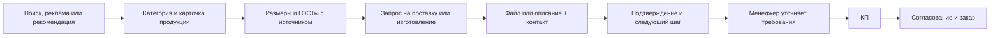

# Аудит сайта как воронки продаж

Проверен опубликованный https://magicmet.ru/ 13 октября 2026 года. Основа проверки: мобильный экран 390 px, текущая главная и форма, ранее проверенные переходы из каталога, карточек и справочников, обработчик заявки. Реальные заявки и письма не отправлялись. Данных о рекламных расходах, конверсии в КП и сделки нет; прогноз роста конверсии не рассчитывался.

Решение пользователя: отдельный лид-магнит не нужен. Цель — прямая воронка продаж: подбор продукции по ГОСТу или чертежу → заявка → КП → заказ. Главный приоритет текущего шага — убрать препятствия в форме. По решению пользователя пункты 4 (новое подтверждение и следующий шаг после отправки) и 5 (аналитика и отслеживание заявки до заказа) отменены. Отдельный лид-магнит также исключён.

## Что уже помогает продавать

- Конкретная специализация: сложные промышленные заявки, редкие позиции, ГОСТы, аналоги, документы и экспорт.
- Каталог с переходами от категории к продукции и её характеристикам.
- Сохранение выбранных наименований, размеров, марки и стандарта при переходе в заявку.
- Приём спецификаций, чертежей, фото и голосовых сообщений; доступные телефон и email.
- Лёгкая главная без загрузки React для первого экрана. Предыдущий лабораторный замер: полностью загруженный hero около 1,1–1,5 с при 1,6 Мбит/с, задержке 150 мс и замедлении CPU в 4 раза. Это симуляция, а не статистика посетителей.

## Найденные препятствия

| Приоритет | Наблюдение | Предлагаемая правка |
| --- | --- | --- |
| 1 | Спецификация приложена, контакт и согласие заполнены, но пустое описание блокирует форму. На живом сайте `checkValidity()` возвращает false; единственное невалидное поле — `message`. Обработчик уже разрешает файл вместо описания. | Принимать **файл или описание**, затем один способ связи. Явно написать «Достаточно телефона или email». |
| 1 | Заголовок «Отправьте заявку» плохо различим на синем фоне блока, особенно слово «заявку». | Сделать заголовок контрастным; на телефоне оставить короткую, читаемую форму. |
| 2 | «Отправить заявку» сообщает действие, но не конкретную пользу. Первый экран перечисляет возможности компании. | Рядом с существующим заголовком обозначить результат: проверка спецификации, вопросы по ГОСТам и вариант комплектации. Сделать кнопку с этим смыслом. |
| 2 | На опубликованной главной загружается только `home.js`; счётчики и события аналитики из React-компонента не подключены к статической странице. | Отменено пользователем; новых счётчиков и событий не добавлять. |
| 2 | Статическая форма передаёт `landingPage`, но не передаёт `utm_source`, `utm_medium`, `utm_campaign` и `referrer`, которые ожидает обработчик. URL страницы сохраняется, однако отдельные поля источника не заполняются. | Не входит в согласованный шаг; работа над аналитикой отменена. |
| 3 | Подтверждение сводится к «Мы свяжемся с вами». Пользователь не видит следующего шага, срока ответа или номера обращения. | Отменено пользователем; существующее сообщение после отправки сохраняется. |
| 3 | Есть сведения об опыте и логотипы подрядных организаций, но на главной нет коротких разборов конкретных задач и результата поставки. | Добавить 2–3 подтверждённых кейса: задача → решение → результат; приложить реальные фото и примеры документов с разрешением на публикацию. |

## Прямой запрос на поставку или изготовление

Основное действие — **«Получить расчёт по ГОСТу или чертежу»**. В каталоге остаются понятные переходы «Размеры, описание и ГОСТы» и «Заявка на производство». Клиент передаёт спецификацию либо краткое описание, затем один способ связи; выбранная продукция и известные параметры сохраняются.

В ответ компания уточняет требования и готовит коммерческое предложение на поставку или изготовление. Отдельные бесплатные материалы, выдача справочника за контакт и бесплатная проверка как самостоятельный оффер исключены по решению пользователя.

Размеры и таблицы ГОСТов полезны как открытая информация для подбора. В карточке нужны источник, редакция стандарта, тип/исполнение и ограничения применимости. Нормативный размер и подтверждённое наличие — разные сведения. Для заявки на изготовление особенно важны стандарт или чертёж, исполнение, материал, количество и требования к документам; их можно передать одним файлом.

## Целевой путь покупателя

## Согласованный короткий шаг

Пункты 1–3: принимать файл **или** описание, явно пояснить, что достаточно телефона **или** email, сделать заголовок формы читаемым на синем фоне. Исправления формы находятся в коммите `00d93f5`; подтверждение отправки и аналитика не изменялись. Проверены телефонный и компьютерный экраны, отрицательные случаи, сохранение файла после ошибки и форма без JavaScript. Отправка проверялась с тестовыми ответами сервера, без реальных заявок.

В текущую правку каталога включены светлое выделение разделов и ссылки «Размеры, описание и ГОСТы» / «Заявка на производство». Оформление каталога завершается отдельным шагом: светлые заголовки, ссылка на размеры/описание/ГОСТы и прямая заявка на производство; для оборудования без отдельной карточки — заявка на комплектацию. Аналитика и новый следующий шаг после отправки отменены пользователем. Отдельный лид-магнит исключён по решению пользователя. Таблицы ГОСТов в этом аудите не добавлялись: доступ к Росстандарту блокирует политика сети среды, а найденные вторичные источники не подтверждают полный нормативный ряд. Разрешение `protect.gost.ru` добавлено в черновик настроек среды; изменение ещё требует применения и повторной проверки доступа.
